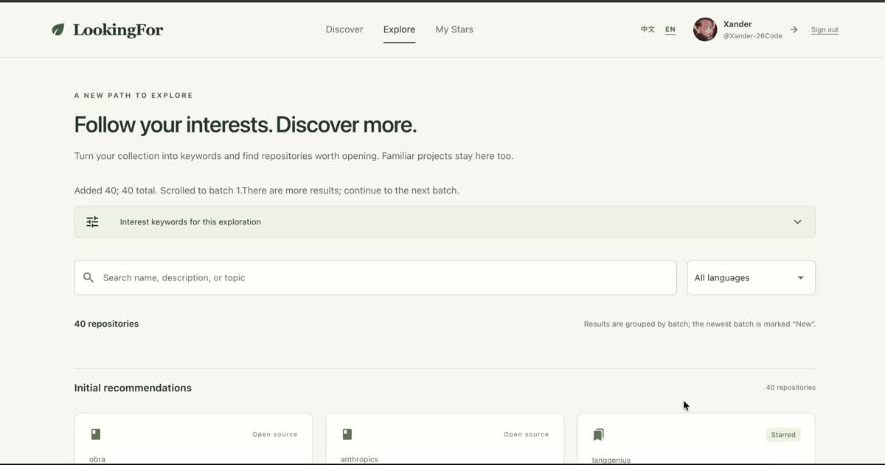

<div align="center">
  <h1>LookingFor</h1>
  <p><strong>Rediscover what you starred. Find what comes next.</strong></p>
  <p>Discover GitHub repositories through the projects you already love.</p>
  <p><strong>English</strong> · <a href="README.zh-CN.md">简体中文</a></p>
  <p>
    <a href="https://repofind.click"><strong>Try it online ↗</strong></a>
    · <a href="#features">Features</a>
    · <a href="#demo">Demo</a>
    · <a href="#quick-start">Quick start</a>
  </p>
  <p>
    
    
    <a href="LICENSE"></a>
  </p>
  
</div>

LookingFor turns your GitHub Stars into a starting point for discovery. Connect your account, let AI identify interests in your collection, and browse related repositories—one batch at a time. Familiar projects stay in the mix, so forgotten favorites can find their way back to you.

## Features

| | What you can do |
|---|---|
| 🌱 **Discover through your interests** | Generate search keywords from the descriptions, topics, and languages of your starred repositories. |
| 🧭 **Keep exploring** | Load another batch of GitHub results without repeating repositories already loaded in the current exploration. |
| ⭐ **Rediscover your Stars** | Browse familiar and unfamiliar repositories together. Saved projects carry a **Starred** badge. |
| 🔎 **Find what fits** | Filter loaded repositories by language, or search their names, descriptions, and topics. |
| 📖 **See the details at a glance** | Read descriptions, topics, language, and Star counts, then open the repository on GitHub. |
| 🌐 **Choose your language** | Switch the app between Chinese and English from the header. |
| 🏡 **Make it your own** | Run locally or self-host with Docker. View synced Stars, sign out, and delete your stored account data. |

## Demo

<a href="assets/readme/demo.mp4">
  
</a>
<p align="center"><a href="assets/readme/demo.mp4">Watch the video ↗</a></p>

<details>
<summary>View screenshots</summary>




</details>

## Usage

1. Open [LookingFor](https://repofind.click) and choose **Connect GitHub**.
2. Authorize the app. LookingFor syncs your Stars and automatically analyzes your interests.
3. Browse **Explore**, narrow the loaded results with the search box or language filter, and open anything that catches your eye.
4. Choose **Continue to the next batch** to discover more. Visit **My Stars** whenever you want to browse your saved collection.

The online beta requires GitHub sign-in and a nonempty Stars list. The **New** badge marks repositories added in the latest browsing batch; **Starred** marks repositories in your synced collection. A repository can have both badges.

## Quick start

**You will need:** Python 3.13+, Redis 7+, a GitHub App Client ID and Client secret, and a DeepSeek API key. Docker is optional for local development; the Redis command below uses it.

### 1. Install

```bash
git clone https://github.com/Xander-26Code/LookingFor.git
cd LookingFor
python3 -m venv .venv
source .venv/bin/activate
pip install -r requirements.txt
cp .env.example .env
```

### 2. Configure

Start Redis, or use an existing instance:

```bash
docker run --rm -p 127.0.0.1:6379:6379 redis:7-alpine
```

In another terminal, generate a session secret:

```bash
python3 -c "import secrets; print(secrets.token_urlsafe(48))"
```

Fill in `.env`, using the generated value for `STORAGE_SECRET`:

```dotenv
GITHUB_CLIENT_ID=your_client_id
GITHUB_CLIENT_SECRET=your_client_secret
GITHUB_REDIRECT_URI=http://127.0.0.1:8080/auth/github/callback
STORAGE_SECRET=your_generated_secret
DEEPSEEK_API_KEY=your_deepseek_api_key
REDIS_URL=redis://127.0.0.1:6379/0
```

In your **GitHub App** settings, set the callback URL to `http://127.0.0.1:8080/auth/github/callback`, disable webhooks, and start with **Metadata: read** permission. Choose **Any account** if others will use the app. Expiring tokens are supported through token refresh.

Use `127.0.0.1` consistently in the browser and callback settings; replace the `localhost` callback from the copied `.env.example` with the value above.

### 3. Run

```bash
python3 main.py
```

Open [127.0.0.1:8080](http://127.0.0.1:8080), connect GitHub, and start exploring.

<details>
<summary>Additional configuration</summary>

The remaining local defaults are provided in [.env.example](.env.example).

| Variable | Purpose |
|---|---|
| `DATABASE_PATH` | SQLite file; defaults to `./lookingfor.db` |
| `NICEGUI_STORAGE_PATH` | Server-side session files; defaults to `./.nicegui` |
| `HOST` / `PORT` | Listen address; defaults to `127.0.0.1:8080` |
| `RELOAD` / `SHOW` | Development reload and automatic browser opening |
| `LOG_LEVEL` / `UVICORN_LOG_LEVEL` | Application and server logging levels |
| `NICEGUI_REDIS_URL` | Optional Redis-backed session storage |
| `DOMAIN` | Public hostname for Caddy in Docker deployment |
| `BACKUP_DIR` | Directory used by `scripts/backup_db.py` |

Keep `STORAGE_SECRET` stable between restarts. Keep `.env`, databases, session files, backups, and API keys out of Git.

</details>

## Self-hosting

Docker Compose runs LookingFor, Redis, and Caddy together, with persistent data and HTTPS for your domain.

Prepare your domain and production `.env` using the [deployment guide](DEPLOYMENT.md) (Chinese), then start the services:

```bash
docker compose up -d --build
```

The supported setup uses **one app instance**. The guide also covers logs, health checks, updates, backups, and recovery.

## Good to know

<details>
<summary>How does LookingFor find repositories?</summary>

DeepSeek extracts interest keywords from your Stars. LookingFor uses those keywords to search public GitHub repositories, merges duplicates, and presents the results in batches. Search currently favors Star counts; the keyword labels describe which query groups returned a result.

</details>

<details>
<summary>Can I keep loading results indefinitely?</summary>

You can continue while the current queries have more results. GitHub limits each search to 1,000 accessible results. LookingFor reuses cached public results and handles request cooldowns; a temporary error keeps already-loaded results available for retry.

</details>

<details>
<summary>What data is stored or sent to the model?</summary>

SQLite stores your GitHub identity, synced Stars, and analysis keywords. DeepSeek receives selected repository metadata and language/topic counts; repository names and URLs may identify their owners. GitHub tokens are kept in server-side session storage and are not included in the model payload.

Use the app's **Privacy & data** page to read the details and delete stored account data. Backups have their own retention lifecycle. In the current beta, tokens are not encrypted at rest; self-hosters should restrict access to session storage and backups.

</details>

## Contributing

Bug reports, discovery feedback, documentation improvements, and pull requests are welcome. If a result feels unrelated, share the visible search keywords and an example of a repository you expected to find—without tokens, session files, or private data.

Run the existing tests before submitting code changes:

```bash
python3 -m unittest discover -s tests
```

GitHub and DeepSeek calls are mocked in the test suite. Start with [Issues](https://github.com/Xander-26Code/LookingFor/issues) to report a problem or discuss an improvement.

## License

[MIT](LICENSE) © 2026 Haoning Xu.
