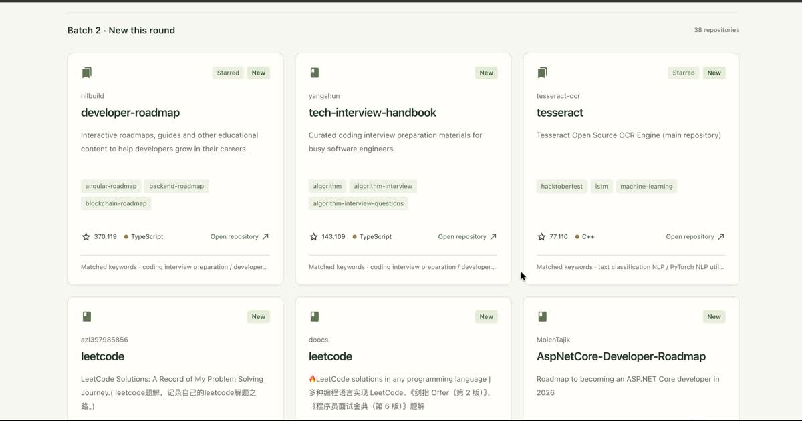
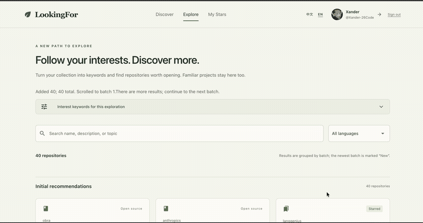
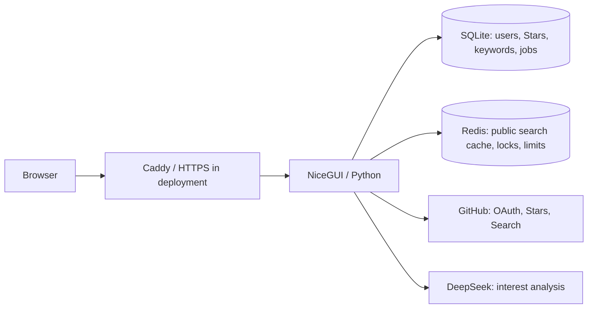

<div align="center">
  <h1>LookingFor</h1>
  <p><strong>Rediscover what you starred. Find what comes next.</strong></p>
  <p>Explore GitHub repositories starting from your Stars, with AI-generated interest keywords.</p>
  <p>
    <a href="https://repofind.click"><strong>Try the beta</strong></a>
    · <a href="#quick-start">Run locally</a>
    · <a href="DEPLOYMENT.md">Self-host</a>
    · <a href="#中文说明">中文说明</a>
  </p>
  <p>
    
    <a href="LICENSE"></a>
  </p>
</div>

Your Stars list records things that caught your attention. LookingFor uses that collection to search for related repositories, so you can keep browsing when GitHub Explore runs out of suggestions—and revisit projects you forgot you saved.

**Connect GitHub → sync your Stars → explore matching repositories → load another batch.**

The [hosted beta](https://repofind.click) requires GitHub sign-in and a nonempty Stars list. Repository metadata is sent to DeepSeek for interest analysis; see [data and privacy](#data-and-privacy) before connecting. You can view the demo below without signing in.

## See the results



Each card shows a description, topics, language, Star count, and a link to GitHub. **Starred** identifies a repository already in your synced collection. **New** means added in the latest batch of this browsing session; it does not mean newly created or previously unknown to you.

Already-starred repositories intentionally remain eligible. Rediscovery is part of the product.

<details>
<summary>Watch the browsing demo</summary>

[](assets/readme/demo.mp4)

[Watch the MP4](assets/readme/demo.mp4) · [Explore page screenshot](assets/readme/search.jpg)

</details>

## What you can do today

- **Start from your collection.** Sync your own Stars and generate search keywords from repository descriptions, topics, and languages.
- **Browse beyond one page.** Load successive batches, with duplicate repositories merged within the current exploration. GitHub search limits still apply.
- **Revisit saved projects.** Keep starred and unstarred results together, with saved projects labeled.
- **Narrow the loaded results.** Filter by language or search their names, descriptions, and topics.
- **Use Chinese or English.** Switch the interface language from the header.
- **Control your account data.** Inspect synced Stars, sign out, or delete stored account data.

## How discovery works today

```text
Your starred repositories
        ↓
DeepSeek interest analysis → saved search keywords
        ↓
GitHub public repository search, ordered by Star count
        ↓
Merge duplicates and group results into browsing batches
        ↓
Within each batch: collected query-keyword count, then Star count
```

**Personalization currently determines what to search for. Ranking is still a simple heuristic.** The model produces interests and supporting repositories, but only the search keywords are retained. GitHub searches use `sort=stars&order=desc`, so popular projects tend to dominate the candidate pool.

The current “Matched keywords” label lists keywords from the query groups that returned a repository. It is **query provenance, not proof that every listed keyword matches**. That count also affects ordering within each batch; replacing it with verified relevance is a planned improvement.

There is no trained recommendation model, semantic reranker, or measured relevance improvement yet. The [roadmap](#roadmap) focuses on testing and improving discovery quality.

## Quick start

### Prerequisites

- Python 3.13+
- Redis 7+
- A **GitHub App** with a Client ID and Client secret
- A DeepSeek API key

### 1. Clone and install

```bash
git clone https://github.com/Xander-26Code/LookingFor.git
cd LookingFor
python3 -m venv .venv
source .venv/bin/activate
pip install -r requirements.txt
```

### 2. Start Redis

Use an existing Redis instance, or run one locally:

```bash
docker run --rm -p 127.0.0.1:6379:6379 redis:7-alpine
```

### 3. Configure

```bash
cp .env.example .env
```

Generate a session secret:

```bash
python3 -c "import secrets; print(secrets.token_urlsafe(48))"
```

Minimum local configuration:

```dotenv
GITHUB_CLIENT_ID=your_client_id
GITHUB_CLIENT_SECRET=your_client_secret
GITHUB_REDIRECT_URI=http://127.0.0.1:8080/auth/github/callback
STORAGE_SECRET=the_generated_secret
DEEPSEEK_API_KEY=your_deepseek_key
REDIS_URL=redis://127.0.0.1:6379/0
DATABASE_PATH=./lookingfor.db
NICEGUI_STORAGE_PATH=./.nicegui
HOST=127.0.0.1
PORT=8080
RELOAD=1
SHOW=1
```

### 4. Configure the GitHub App

In the GitHub App settings:

- **Identifying and authorizing users → Callback URL**:
  `http://127.0.0.1:8080/auth/github/callback`
- **Permissions**: start with `Metadata: read`.
- **Webhook**: disabled; this app does not consume webhooks.
- **Where can this GitHub App be installed?**: choose `Any account` if other people will test it.
- Keep **User-to-server token expiration** enabled; the app supports refreshing expiring tokens.

Use the same host in your browser, `.env`, and GitHub App callback setting. The example above uses `127.0.0.1`; replace the `localhost` callback in the copied `.env.example` accordingly.

### 5. Run

```bash
python3 main.py
```

Open <http://127.0.0.1:8080>, connect GitHub, and sync your Stars.

---

## Deployment

The repository includes a single-host deployment: the app, Redis, and Caddy (automatic HTTPS).

```bash
cp .env.example .env
# Fill in the production values, including DOMAIN.
docker compose up -d --build
docker compose logs -f caddy
```

Production `.env` essentials:

```dotenv
GITHUB_CLIENT_ID=...
GITHUB_CLIENT_SECRET=...
GITHUB_REDIRECT_URI=https://your-domain/auth/github/callback
STORAGE_SECRET=...
DEEPSEEK_API_KEY=...
REDIS_URL=redis://redis:6379/0
DATABASE_PATH=/data/lookingfor.db
NICEGUI_STORAGE_PATH=/data/.nicegui
HOST=0.0.0.0
PORT=8080
RELOAD=0
SHOW=0
DOMAIN=your-domain
BACKUP_DIR=/data/backups
```

Set the GitHub App callback URL to the same `https://your-domain/auth/github/callback`.

The app is intentionally a **single instance**. SQLite and in-process analysis jobs are not designed for horizontal scaling.

More detail: [DEPLOYMENT.md](DEPLOYMENT.md).

---

## Usage

1. Open the home page and choose **Connect GitHub**.
2. Authorize the GitHub App and wait for the star sync to finish.
3. LookingFor automatically starts an interest analysis; if it fails, use **Analyze interests** to retry.
4. Open **Explore** to browse matching repositories. Use **Continue to the next batch** to fetch more results.
5. Use the **中文 / EN** switch in the header to change the interface language.

Important routes:

| Route | Purpose |
|---|---|
| `/` | Home |
| `/stars` | Synced stars |
| `/analyse` | Start or inspect analysis |
| `/search` | Explore matching repositories |
| `/privacy` | Data and privacy explanation |
| `/account/delete` | Delete the current user's data |
| `/auth/logout` | Sign out |
| `/health` | Database + Redis health check |

---

## Configuration

| Variable | Required | Description |
|---|---|---|
| `GITHUB_CLIENT_ID` | Yes | GitHub App Client ID (not the numeric App ID) |
| `GITHUB_CLIENT_SECRET` | Yes | GitHub App Client secret |
| `GITHUB_REDIRECT_URI` | Yes | Must exactly match the GitHub App callback URL |
| `STORAGE_SECRET` | Yes | Signs the NiceGUI session; keep it stable |
| `DEEPSEEK_API_KEY` | Yes | DeepSeek API key |
| `REDIS_URL` | Yes | Redis connection URL |
| `DATABASE_PATH` | No | SQLite path; default `./lookingfor.db` |
| `NICEGUI_STORAGE_PATH` | No | Session storage path; default `./.nicegui` |
| `HOST` / `PORT` | No | Bind address; defaults `127.0.0.1:8080` |
| `RELOAD` / `SHOW` | No | Development reload / browser auto-open |
| `DOMAIN` | Docker | Hostname used by Caddy |
| `BACKUP_DIR` | No | Backup directory for `scripts/backup_db.py` |
| `NICEGUI_REDIS_URL` | No | Optional Redis-backed session storage |

Keep `.env`, SQLite databases (including WAL files), `.nicegui`, backups, and API keys out of Git.

---

## Data and privacy

- SQLite stores each user's GitHub identity, a Stars snapshot, and generated search keywords, scoped by GitHub user ID.
- GitHub access and refresh tokens are held server-side in NiceGUI session storage, not rendered into the page.
- DeepSeek receives selected repository metadata: names, descriptions, language, topics, URLs, and fork counts, plus language/topic counts. Repository names and URLs may identify their owners; the payload does not include the GitHub token or a separate user email field.
- Redis shares cached **public** search results across users. User Stars and personalized analyses remain separate.
- `/privacy` explains data handling; `/account/delete` deletes the current user's stored account data. Backups have a separate retention lifecycle; see the [deployment guide](DEPLOYMENT.md).
- **Beta limitation:** access and refresh tokens are not encrypted at rest. Restrict access to session storage and backups. Encryption and additional model-spend controls remain release work.

## Architecture

The app is a single Python service with NiceGUI for the UI, SQLite for per-user data, and Redis for search caching and request coordination.



Analysis runs in a background job within the app process. Closing or refreshing a browser page does not cancel it; requests for the same user's current analysis join the running job. This does not make jobs durable across a server restart.

<details>
<summary>Current processing limits and defaults</summary>

- Model input is compacted: descriptions up to 300 characters and up to 8 topics of 40 characters each.
- Input is split into batches of at most 120,000 characters. If it would exceed 6 batches, representative sampling reduces the input to at most 600 repositories, potentially fewer to fit the budget.
- Each batch can make up to 3 model attempts: thinking enabled with an 8,192-token output budget, then without thinking at 8,192 and 16,384 if content is empty or invalid JSON. **Six input batches are not a six-request cost cap.**
- At most 80 keywords are retained. Queries normally group up to 4 keywords with `OR` and restrict results to public repositories.
- GitHub search requests 10 results per page and can retrieve at most 1,000 results per query. “Continue” advances existing queries; it does not generate an unlimited supply of new queries.
- Public search pages are cached for 6 hours. Redis coordinates duplicate fetches and a per-user request limit, and honors GitHub cooldown responses.
- Analysis defaults: 60-second cooldown, 10 attempts per 24 hours per user, and 2 active jobs globally. Failed analyses count toward the attempt limit.
- Supported deployment is one app instance. Shared Redis alone does not make SQLite, sessions, and in-process jobs a horizontally scaled service.

</details>

## Tests

```bash
python3 -m unittest discover -s tests
```

The suite covers account/session behavior, analysis jobs and batching, input compaction, model-response fallback, SQLite deletion/backups, Redis search protection, and discovery pagination. External GitHub and DeepSeek calls are mocked. These are correctness tests, **not an evaluation of recommendation quality**.

## Project structure

| File | Responsibility |
|---|---|
| [main.py](main.py) | Routes, OAuth, Star sync, analysis/search orchestration, health check |
| [views.py](views.py), [styles.css](styles.css), [i18n.py](i18n.py) | Repository browser, styling, Chinese/English UI |
| [analyse.py](analyse.py) | Input compaction, model calls, keyword extraction |
| [analysis_jobs.py](analysis_jobs.py) | Background jobs, leases, duplicate-analysis protection |
| [database.py](database.py) | Per-user SQLite data, analysis limits, deletion, backups |
| [search.py](search.py) | GitHub queries and public-repository filtering |
| [search_guard.py](search_guard.py) | Redis page cache, request locks, rate limiting |
| [discovery.py](discovery.py) | Query pagination, merging, browsing batches |
| [scripts/backup_db.py](scripts/backup_db.py) | Online SQLite backup with retention |
| [tests/](tests/) | Automated correctness tests |
| [DEPLOYMENT.md](DEPLOYMENT.md) | Docker, Caddy, operations, and backup instructions |

## Roadmap

These are planned changes, not current features or measured results.

- [ ] Establish a small, human-reviewed evaluation set and record the current ranking as a baseline.
- [ ] Preserve structured interests and verified supporting repositories, instead of keeping only keywords.
- [ ] Add retrieval channels alongside the existing Star-sorted search to test broader candidate coverage.
- [ ] Rank candidates by relevance and diversify the results while keeping already-starred projects eligible.
- [ ] Show recommendation reasons supported by actual repository metadata.
- [ ] Gather optional feedback about relevance and rediscovery value.
- [ ] Encrypt stored GitHub tokens and add beta access controls and model-spend monitoring.

## Contributing

Useful contributions include reproducible search problems, evaluation cases, query strategies, ranking experiments, and documentation fixes.

For a discovery-quality issue, include the interest you expected, the visible query keywords, an unsuitable public result, and an example of a more useful repository. If you have no Stars or receive no results, report that too. Do not attach tokens, `.env`, session files, or private repository metadata.

[Open an issue](https://github.com/Xander-26Code/LookingFor/issues). For code changes, explain the behavior and run the test suite. For ranking changes, include a comparison with the current baseline; a different result list alone does not establish an improvement.

## 中文说明

**LookingFor 从你的 GitHub Stars 提炼兴趣关键词，帮助你继续探索相关仓库，也重新发现忘记收藏过的项目。**

- [在线 beta](https://repofind.click) 需要 GitHub 登录及非空 Stars 列表；无需登录即可观看上方演示。
- 登录后同步收藏，分析兴趣，再分批浏览结果；可以按语言和文本筛选已加载的仓库。
- 已 Star 的仓库会保留并标记。“New”只代表本次浏览最新批次新增，不代表你从未见过。
- 当前个性化主要体现在搜索词。候选仍按 Star 数检索，批内按收集的查询词数量和 Star 数排序；还没有经过评估的个性化重排算法。
- “匹配关键词”目前表示仓库来自哪些查询组，不能证明它命中了组内每个关键词。兴趣证据保留、真实相关性排序、多样性和评估属于下一阶段。
- 自部署需要 Python、Redis、GitHub App 和 DeepSeek API Key，具体见 [Quick start](#quick-start) 与 [部署文档](DEPLOYMENT.md)。
- 仓库元数据会发送给 DeepSeek；GitHub token 保存在服务端，但目前没有静态加密。项目目前支持单实例部署。

## License

MIT © 2026 Haoning Xu. See [LICENSE](LICENSE).
