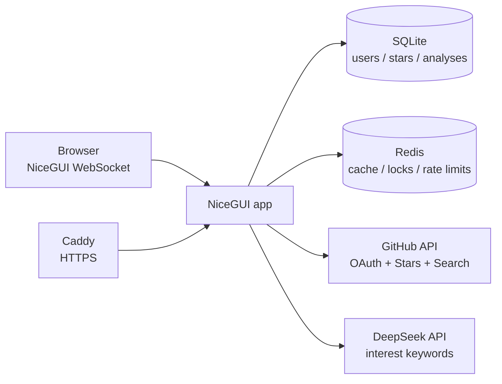

# LookingFor

**An AI-assisted way to rediscover GitHub repositories you already love — and find the next ones.**

LookingFor connects to your GitHub account, reads the repositories you have starred, and turns them into an interest profile used to search for related open-source projects. It is built for people whose Stars list has become a small, messy map of their curiosity.

[Live beta](https://47-79-237-57.sslip.io) · [Deployment guide](DEPLOYMENT.md) · [中文说明](#中文说明)

> The live URL is a temporary beta address. A custom domain is planned.

---

## Overview

Most repository discovery tools start from a search box. LookingFor starts from **what you already saved**.

1. Sign in with GitHub.
2. Sync your starred repositories.
3. Let DeepSeek turn the collection into a compact interest profile and search keywords.
4. Explore matching repositories in batches, including projects you have already starred.
5. Keep fetching new batches as long as GitHub has more results.

The app is deliberately a single long-running Python service: NiceGUI for the UI, SQLite for user data, Redis for cache and coordination, and GitHub + DeepSeek as external APIs.

---

## Features

- **GitHub OAuth login** — sign-in is required; there is no anonymous mode.
- **Star sync** — imports the authenticated user's starred repositories, with per-user isolation.
- **AI interest analysis** — DeepSeek generates English search keywords from repository metadata.
- **Batched analysis** — large collections are split by input budget (up to 6 model calls), with a representative fallback for very large lists.
- **Resilient model calls** — retries without thinking when the model returns empty content or truncated JSON.
- **Repository search** — GitHub search grouped by keywords, with Redis caching, single-flight locks, and rate limiting.
- **Continue discovering** — pages advance by group; new results are appended as a new batch and marked as new.
- **Chinese / English UI** — switch language from the header; the preference is stored per session.
- **Account controls** — sign out, privacy/data explanation, and irreversible data deletion.
- **Operational basics** — `/health`, Docker Compose, Caddy HTTPS, SQLite online backups, structured logs.
- **Tests** — 62 unit tests covering account auth, i18n, analysis flow, database, search guard, and discovery.

---

## Architecture



Analysis is executed as an independent background job. Refreshing or closing a page does not cancel the model call, and multiple pages requesting the same analysis join the existing job instead of paying for a duplicate call.

---

## Tech stack

| Layer | Technology |
|---|---|
| Language | Python 3.13 |
| Web UI | NiceGUI 3.18 |
| Model | DeepSeek via the OpenAI-compatible SDK |
| Persistence | SQLite in WAL mode |
| Cache / coordination | Redis 7+ |
| Deployment | Docker Compose + Caddy |

---

## Quick start

### Prerequisites

- Python 3.13+
- Redis 7+
- A **GitHub App** with a Client ID and Client secret
- A DeepSeek API key

### 1. Clone and install

```bash
git clone https://github.com/Xander-26Code/LookingFor.git
cd LookingFor
python3 -m venv .venv
source .venv/bin/activate
pip install -r requirements.txt
```

### 2. Start Redis

Use an existing Redis instance, or run one locally:

```bash
docker run --rm -p 6379:6379 redis:7-alpine
```

### 3. Configure

```bash
cp .env.example .env
```

Generate a session secret:

```bash
python3 -c "import secrets; print(secrets.token_urlsafe(48))"
```

Minimum local configuration:

```dotenv
GITHUB_CLIENT_ID=your_client_id
GITHUB_CLIENT_SECRET=your_client_secret
GITHUB_REDIRECT_URI=http://127.0.0.1:8080/auth/github/callback
STORAGE_SECRET=the_generated_secret
DEEPSEEK_API_KEY=your_deepseek_key
REDIS_URL=redis://127.0.0.1:6379/0
DATABASE_PATH=./lookingfor.db
NICEGUI_STORAGE_PATH=./.nicegui
HOST=127.0.0.1
PORT=8080
RELOAD=1
SHOW=1
```

### 4. Configure the GitHub App

In the GitHub App settings:

- **Identifying and authorizing users → Callback URL**:
  `http://127.0.0.1:8080/auth/github/callback`
- **Permissions**: start with `Metadata: read`.
- **Webhook**: disabled; this app does not consume webhooks.
- **Where can this GitHub App be installed?**: choose `Any account` if other people will test it.
- For a small beta, you can opt out of **User-to-server token expiration**. The app also supports refresh tokens if you keep expiration enabled.

### 5. Run

```bash
python3 main.py
```

Open <http://127.0.0.1:8080>, connect GitHub, and sync your Stars.

---

## Docker deployment

The repository includes a single-host deployment: the app, Redis, and Caddy (automatic HTTPS).

```bash
cp .env.example .env
# Fill in the production values, including DOMAIN.
docker compose up -d --build
docker compose logs -f caddy
```

Production `.env` essentials:

```dotenv
GITHUB_CLIENT_ID=...
GITHUB_CLIENT_SECRET=...
GITHUB_REDIRECT_URI=https://your-domain/auth/github/callback
STORAGE_SECRET=...
DEEPSEEK_API_KEY=...
REDIS_URL=redis://redis:6379/0
DATABASE_PATH=/data/lookingfor.db
NICEGUI_STORAGE_PATH=/data/.nicegui
HOST=0.0.0.0
PORT=8080
RELOAD=0
SHOW=0
DOMAIN=your-domain
BACKUP_DIR=/data/backups
```

Set the GitHub App callback URL to the same `https://your-domain/auth/github/callback`.

The app is intentionally a **single instance**. SQLite and in-process analysis jobs are not designed for horizontal scaling.

More detail: [DEPLOYMENT.md](DEPLOYMENT.md).

---

## Usage

1. Open the home page and choose **Connect GitHub**.
2. Authorize the GitHub App and wait for the star sync to finish.
3. LookingFor automatically starts an interest analysis; if it fails, use **Analyze interests** to retry.
4. Open **Explore** to see recommendations. Use **Continue to the next batch** to fetch more results.
5. Use the **中文 / EN** switch in the header to change the interface language.

Important routes:

| Route | Purpose |
|---|---|
| `/` | Home |
| `/stars` | Synced stars |
| `/analyse` | Start or inspect analysis |
| `/search` | Explore recommendations |
| `/privacy` | Data and privacy explanation |
| `/account/delete` | Delete the current user's data |
| `/auth/logout` | Sign out |
| `/health` | Database + Redis health check |

---

## Configuration

| Variable | Required | Description |
|---|---|---|
| `GITHUB_CLIENT_ID` | Yes | GitHub App Client ID (not the numeric App ID) |
| `GITHUB_CLIENT_SECRET` | Yes | GitHub App Client secret |
| `GITHUB_REDIRECT_URI` | Yes | Must exactly match the GitHub App callback URL |
| `STORAGE_SECRET` | Yes | Signs the NiceGUI session; keep it stable |
| `DEEPSEEK_API_KEY` | Yes | DeepSeek API key |
| `REDIS_URL` | Yes | Redis connection URL |
| `DATABASE_PATH` | No | SQLite path; default `./lookingfor.db` |
| `NICEGUI_STORAGE_PATH` | No | Session storage path; default `./.nicegui` |
| `HOST` / `PORT` | No | Bind address; defaults `127.0.0.1:8080` |
| `RELOAD` / `SHOW` | No | Development reload / browser auto-open |
| `DOMAIN` | Docker | Hostname used by Caddy |
| `BACKUP_DIR` | No | Backup directory for `scripts/backup_db.py` |
| `NICEGUI_REDIS_URL` | No | Optional Redis-backed session storage |

Never commit `.env`, `lookingfor.db`, `.nicegui`, or API keys.

---

## How analysis and search behave

- Repository fields are compacted before sending them to the model: description up to 300 characters, up to 8 topics at 40 characters each, compact JSON.
- Each model batch is kept under 120,000 characters. Up to 6 batches are allowed; beyond that, a representative sample of about 600 repositories is used.
- The first model attempt uses `max_tokens=8192` with thinking enabled. If the response is empty or not valid JSON, the app retries with thinking disabled, then with `max_tokens=16384`.
- Search keywords are capped at 80. They are grouped into queries of at most 4 keywords.
- GitHub search returns at most 1,000 results and pages up to 100; the UI reports when a limit is reached.
- Redis caches public search results for 6 hours and coordinates single-flight fetches and rate limits.
- Analysis limits: 60-second cooldown, 10 attempts per 24 hours per user, and 2 active jobs globally. Attempts are recorded even when the model fails.

---

## Data and privacy

- Each user has a row in SQLite plus a star snapshot and one analysis result.
- GitHub tokens are stored server-side in NiceGUI session storage; they are never sent to the browser page.
- The model receives repository metadata (name, description, language, topics, URL, fork count) — not the GitHub token, login, or email.
- Search cache contains public repository results only.
- Users can sign out, read `/privacy`, and delete their data at `/account/delete`.
- **Beta limitation:** session tokens are stored unencrypted at rest. Restrict access to the server and session storage; encryption is planned before a public launch.

---

## Tests

```bash
python3 -m unittest discover -s tests
```

The suite covers OAuth/session behavior, analysis deduplication and batching, input compaction, token fallback, SQLite deletion/backups, Redis search protection, and discovery pagination. It makes no real GitHub or DeepSeek requests.

---

## Project structure

```text
main.py             Routes, OAuth, analysis UI, search UI, health check
views.py            Reusable UI components and repository browser
i18n.py             Chinese/English UI helper
analyse.py          Input compaction, batching, DeepSeek calls, keyword extraction
analysis_jobs.py    Background analysis job, lease heartbeat, deduplication
database.py         SQLite schema, per-user data, analysis attempts, backups
search.py           GitHub search requests and public-repository filtering
search_guard.py     Redis cache, single-flight lock, rate limiter, cooldown
discovery.py        Batch/page rotation for “continue discovering”
scripts/backup_db.py  Online SQLite backup with retention
tests/              Unit tests (62)
DEPLOYMENT.md       Single-host deployment notes
Dockerfile          App image
docker-compose.yml  App + Redis + Caddy
Caddyfile           Automatic HTTPS reverse proxy
```

---

## Roadmap / known gaps

- [ ] Add a beta allowlist to control model spend before sharing the link broadly.
- [ ] Encrypt GitHub tokens and refresh tokens at rest.
- [ ] Add a screenshot or short demo GIF to this README.
- [ ] Switch the live demo from the temporary `sslip.io` address to `repofind.click`.
- [ ] Add a real allowlist / invitation flow and usage budget alerts.
- [ ] Add a proper open-source license.

---

## License

TODO: add a `LICENSE` file before publishing. No license has been chosen yet.

---

## 中文说明

**LookingFor 是一个从你的 GitHub Stars 出发、用 AI 帮你重新发现和继续发现开源仓库的工具。**

### 它做什么

1. 用 GitHub 登录；
2. 同步你收藏的 Stars；
3. 让 DeepSeek 从仓库描述、语言、topics 中提炼兴趣关键词；
4. 按关键词搜索 GitHub 公开仓库；
5. 用“继续发现下一批”不断追加新结果，并标出本次新增。

### 本地运行

```bash
python3 -m venv .venv
source .venv/bin/activate
pip install -r requirements.txt
cp .env.example .env
# 填写 GitHub App、DeepSeek、Redis 配置
python3 main.py
```

打开 <http://127.0.0.1:8080>。

### 线上部署

项目自带 `Dockerfile`、`docker-compose.yml` 和 `Caddyfile`：

```bash
cp .env.example .env
# 填写生产配置，包括 DOMAIN
docker compose up -d --build
```

详细步骤见 [DEPLOYMENT.md](DEPLOYMENT.md)。

### 当前限制

- 单实例部署，SQLite 不适合直接水平扩展；
- beta 阶段的 token 尚未加密存储；
- 还没有内测白名单，公开链接前建议先加；
- 域名 `repofind.click` 还在实名/解析流程中，目前使用临时 `sslip.io` 地址；
- 尚未添加 LICENSE。

### 测试

```bash
python3 -m unittest discover -s tests
```

当前 62 个测试通过，不访问真实 GitHub 或 DeepSeek API。

---

Built with curiosity, NiceGUI, SQLite, Redis, GitHub, and DeepSeek.
